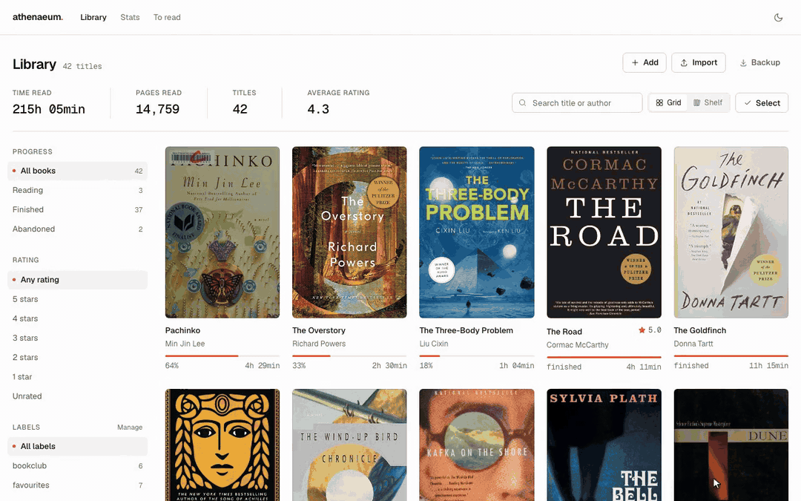

<div align="center">
    <br/>
    <p>
        
        <h1>athenaeum</h1>
    </p>
    <p width="120">
        Personal reading archive: KOReader statistics, highlights and your own verdicts in one private place.
    </p>
    <br/>
</div>

<div align="center">

<p><sub>32-second tour &middot; <a href="assets/demo.mp4">full-quality MP4 (1.3&nbsp;MB)</a></sub></p>
</div>

## Features

- **Library** — cover grid or shelf view with search, sorting (title, author, rating, time, pages, added) and filters by status, rating and label.
- **Books** — title, author, ISBN, pages, reading time, progress, rating, review and cover. Add books manually (metadata filled in from Open Library by ISBN), edit, rate or delete them, or select several at once for bulk labeling and status changes.
- **Pace & time left** — reading speed in pages per hour, estimated time left in the current book and a projected finish date based on your last two weeks.
- **KOReader import** — sync books, sessions, highlights, notes and bookmarks over Wi-Fi with koinsight.koplugin, or upload the device's SQLite file.
- **Annotations** — highlights, notes and bookmarks per book, editable and deletable, exportable as Markdown.
- **Statistics** — totals, current and best streak, best and longest day, 12-month reading, average time per weekday, time-of-day profile and top books.
- **Calendar** — per-day reading time and pages, broken down by book.
- **To-read list** — wishlist kept separate from the library.
- **Labels** — tag books and browse the library by tag.
- **Covers** — fetched from Open Library by ISBN, or uploaded manually; a generated placeholder when offline.
- **Own your data** — whole SQLite database downloadable at any time; single file, no external service.
- **Private by default** — password gate, single-owner instance, dark mode, phone and desktop layouts.

## Run locally

```sh
uv sync
uv run uvicorn app.main:app --host 0.0.0.0 --port <port>
```

Accessible through http://localhost:<port>

## Docker

```sh
docker build -t athenaeum .
docker run -p 8000:8000 -v athenaeum-data:/data athenaeum
```

## Docker Compose

```yaml
services:
  athenaeum:
    image: ghcr.io/xhugo21/athenaeum:latest
    user: "568:568"
    ports:
      - "9372:8000"
    volumes:
      - /stacks/athenaeum:/data
    restart: unless-stopped
    environment:
      - ATHENAEUM_PASSWORD=changeme
```

## KOReader plugin sync

Supports [koinsight.koplugin](https://github.com/Ko-Insight/KoInsight/tree/master/plugins/koinsight.koplugin) (kudos to KoInsight).

Syncs books, reading stats, highlights, notes and bookmarks straight from the device over Wi-Fi.

Install on your e-reader and point it to your athenaeum URL
